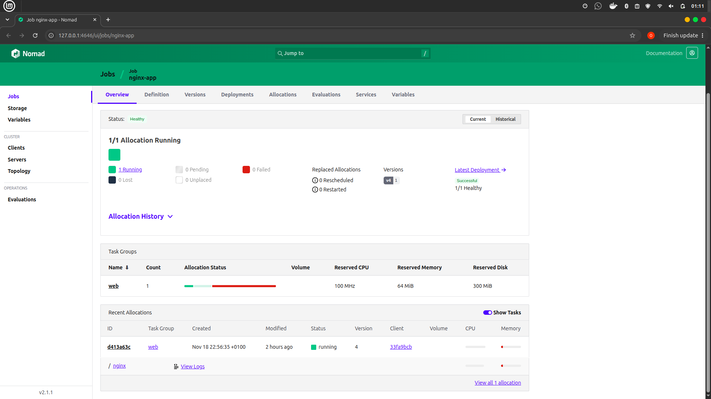
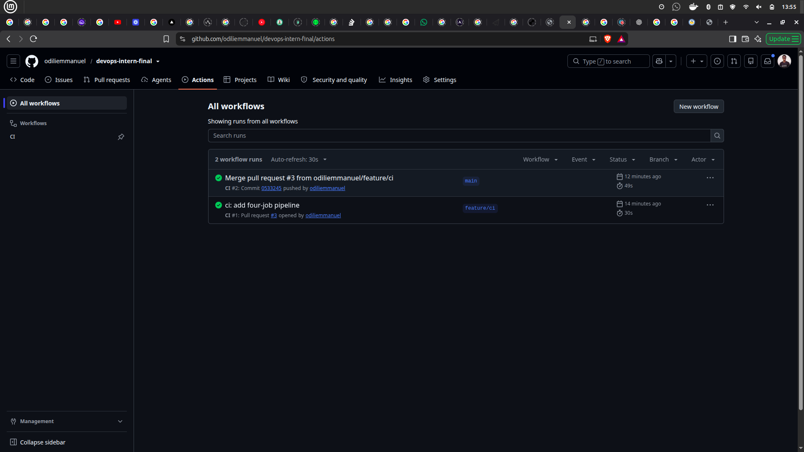
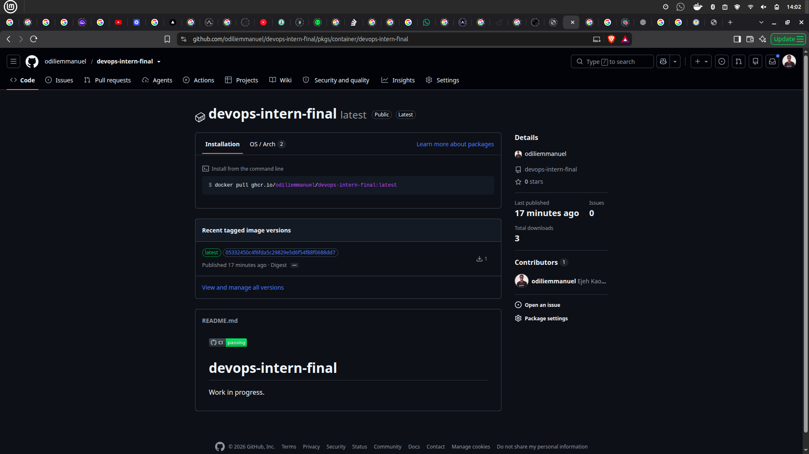
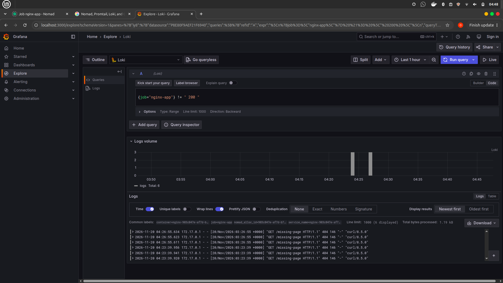

[](https://github.com/odiliemmanuel/devops-intern-final/actions/workflows/ci.yml)

# devops-intern-final

**Name:** Ejeh Kaodilichi Emmanuel
**Submission date:** 20 November 2026
**Repository:** https://github.com/odiliemmanuel/devops-intern-final
**Release:** `v1.0.0`

An end-to-end pipeline for a containerised NGINX web application: source control, a hardened container image, GitHub Actions CI, deployment on HashiCorp Nomad (with Consul health checks), and log aggregation with Grafana Loki. Each stage consumes the output of the previous one: the image that CI builds and tests is the image that is published to GHCR, the image that Nomad deploys (by commit SHA), and the container whose logs end up in Loki.

## Architecture

```
 developer ──push / pull request──▶ GitHub (main)
                                        │
                                        ▼
                               GitHub Actions CI
        lint ──▶ build ──▶ test ──▶ publish   (publish: push to main only)
                                        │  push :<commit-sha> and :latest
                                        ▼
                                  ghcr.io (public)
                                        │  docker pull, tag = commit SHA
                                        ▼
              Nomad (docker driver)  +  Consul service check on /healthz
                                        │  container stdout (nginx access log)
                                        ▼
                  Promtail ──▶ Loki ──▶ Grafana (LogQL in Explore)
```

## Repository layout

```
devops-intern-final/
├── README.md
├── .gitignore
├── app/            Dockerfile, index.html, nginx.conf (+ LICENSE of the vendored page)
├── scripts/        sysinfo.sh, healthcheck.sh
├── .github/workflows/ci.yml
├── nomad/          nginx-app.nomad.hcl
├── monitoring/     loki-config.yaml, promtail-config.yaml, docker-compose.yaml, loki_setup.md
└── docs/screenshots/
```

## Prerequisites (versions used)

| Tool | Version |
|---|---|
| Git | 2.43.0 |
| Docker Engine / CLI | 29.9.3 |
| Docker Compose | v5.3.1 |
| ShellCheck | 0.9.0 |
| Hadolint | 2.15.1 (run via Docker, pinned by digest in CI) |
| GitHub CLI | 2.45.0 |
| Nomad | v2.1.1 |
| Consul | v2.1.0 |
| Loki / Promtail | 3.4.2 |
| Grafana | 11.5.2 |

Nomad and Consul were installed from HashiCorp's apt repository; the Ubuntu and snap packages were far too old.

## Quick Start (clone to running application)

```bash
git clone https://github.com/odiliemmanuel/devops-intern-final.git
cd devops-intern-final
docker build --build-arg BUILD_SHA=$(git rev-parse --short HEAD) -t devops-intern-final:local app
docker run -d --name web -p 8080:8080 devops-intern-final:local
./scripts/healthcheck.sh
```

Five commands. The page is at http://localhost:8080 and the health endpoint at http://localhost:8080/healthz. Remove the container afterwards with `docker rm -f web`.

### Full stack (Nomad + Loki)

Open three terminals. Nomad runs as root and uses the native Docker engine (`/var/run/docker.sock`); if you also have Docker Desktop, run the monitoring stack with `sudo docker compose` so that Promtail sees the same engine as Nomad (see Troubleshooting).

```bash
consul agent -dev                                            # terminal 1
sudo nomad agent -dev                                        # terminal 2
nomad job run -var image_tag=05332450c4f6fda5c29829e5d6f54f88f0688dd7 nomad/nginx-app.nomad.hcl
cd monitoring && sudo docker compose up -d                   # Grafana on http://localhost:3000
```

---

## Task 1: Source control

- Public repository `devops-intern-final`, built up in small commits with conventional messages (`feat:`, `fix:`, `docs:`, `ci:`, `chore:`, `perf:`).
- Every stage was developed on its own `feature/*` branch and merged into `main` through a pull request that I opened and self-reviewed with a comment (see the *Pull requests* tab). Merges use merge commits so the incremental history stays visible.
- `.gitignore` excludes IDE metadata (`.idea/`, `.vscode/`), secrets (`.env`, `*.pem`, `*.key`) and local artefacts. No IDE metadata is committed.
- The final state is tagged `v1.0.0`.

```text
$ git log --oneline --graph | head -30
*   11ed1f9 Merge pull request #6 from odiliemmanuel/feature/docs-screenshots
|\
| * dc73462 chore: remove stray root docker-compose.yaml (real one is in monitoring/)
| * 4e2133b docs: add CI run and GHCR package screenshots
|/
*   a81a09d Merge pull request #5 from odiliemmanuel/feature/loki
|\
| * 16c2c99 docs: add Loki setup notes and Grafana Explore screenshot
| * 797f2bd feat: add compose stack for Loki, Promtail and Grafana
| * d8d4c71 feat: add Promtail config scraping Nomad docker logs with labels
| * ffbd9ca feat: add Loki single-binary config
| * ca53446 feat: add compose stack for Loki, Promtail and Grafana
| * 8844218 feat: add Promtail config scraping Nomad docker logs with labels
| * ed6203b feat: add Loki single-binary config
| * 2f80674 feat: add Loki single-binary config
|/
*   512e66b Merge pull request #4 from odiliemmanuel/feature/nomad
|\
| * e53163b docs: add Nomad UI screenshots (healthy allocation and auto-revert)
| * 8e6caec docs: add Nomad UI screenshot showing healthy allocation
| * 72d8716 docs: add Nomad UI screenshot showing healthy allocation
| * 6feddc9 feat: add Nomad job for nginx-app
|/
*   0533245 Merge pull request #3 from odiliemmanuel/feature/ci
|\
| * a446fa6 docs: add CI status badge to README
| * d3e17c7 ci: add publish job pushing SHA and latest tags to GHCR
| * 895561a ci: add test job running healthcheck.sh against the container
| * 9e1abc9 ci: add workflow with shellcheck and hadolint lint job
| * e080a7a ci: add workflow with shellcheck and hadolint lint job
```

**Acknowledgement.** `app/index.html` is vendored from [ameyrupji-k8s/k8s-docker-nginx-static-html-demo](https://github.com/ameyrupji-k8s/k8s-docker-nginx-static-html-demo), which is licensed under GPL-3.0; its license text is kept in `app/LICENSE`. I replaced its Kubernetes manifests with a Nomad job, rewrote the Dockerfile, and modified the page to show my name, the date and the build ID. The Dockerfile, `nginx.conf`, scripts, CI workflow, Nomad job and monitoring configuration are my own work.

## Task 2: Linux scripting

Both scripts live in `scripts/`, start with a shebang, use `set -euo pipefail`, are `ShellCheck` clean, and are stored as executable in Git (mode `100755`, checked with `git ls-files --stage scripts/`).

I used `#!/usr/bin/env bash` rather than `#!/bin/sh` on purpose: the assignment asks for `set -euo pipefail`, and `pipefail` is not supported by every POSIX `sh` (Ubuntu's `/bin/sh` is dash). The code itself sticks to portable constructs (no arrays, no `[[ ]]`).

### `sysinfo.sh`

Reports user and effective UID, hostname, kernel release, ISO-8601 date, disk usage, memory and Docker daemon status.

```text
=== System information ===
User:       odili (effective UID: 1000)
Hostname:   odili-Latitude-7490
Kernel:     6.8.0-149-generic
Date (UTC): 2026-11-16T10:59:43Z

=== Disk usage (human-readable) ===
Filesystem      Size  Used Avail Use% Mounted on
/dev/nvme0n1p2  234G  222G  268M 100% /

=== Memory usage ===
               total        used        free      shared  buff/cache   available
Mem:           7.6Gi       6.3Gi       358Mi       775Mi       2.0Gi       1.3Gi
Swap:           20Gi       8.8Gi        11Gi

=== Docker daemon ===
running
```

(The nearly full disk shown here was real; see Known Limitations.)

### `healthcheck.sh`

Takes a URL as `$1` (default `http://localhost:8080`), asserts an HTTP 200, and exits `0` on success, `1` on failure or unreachable, `2` if `curl` is missing.

```text
$ ./scripts/healthcheck.sh
OK: http://localhost:8080 returned HTTP 200
exit=0

$ ./scripts/healthcheck.sh http://localhost:8080/nope
FAIL: http://localhost:8080/nope returned HTTP 404 (expected 200)
exit=1

$ ./scripts/healthcheck.sh http://localhost:9999
FAIL: http://localhost:9999 returned HTTP 000 (expected 200)
exit=1
```

## Task 3: Containerisation

`app/Dockerfile` is based on the pinned tag `nginx:1.27-alpine-slim`. It copies a custom `nginx.conf` that listens on **8080** and serves `/healthz`, runs as the non-root user (numeric `USER 101`), declares `EXPOSE 8080` and a `HEALTHCHECK`, and accepts a `BUILD_SHA` build argument that is written into the served page (and an image label).

```bash
docker build --build-arg BUILD_SHA=$(git rev-parse --short HEAD) -t devops-intern-final:local app
docker run -d --name web -p 8080:8080 devops-intern-final:local
```

Evidence:

```text
$ curl -i localhost:8080/
HTTP/1.1 200 OK
Server: nginx
Content-Type: text/html
...
<h1>DevOps Final Assessment</h1>
<p>Ejeh Kaodilichi Emmanuel</p>
<p>Date: 16 November 2026</p>
<p>Build: 5646f13</p>

$ curl -i localhost:8080/healthz
HTTP/1.1 200 OK
Content-Type: text/plain

ok

$ curl -i localhost:8080/nope
HTTP/1.1 404 Not Found

$ docker images devops-intern-final
IMAGE                       ID             DISK USAGE   CONTENT SIZE
devops-intern-final:local   b5e913edb940       19.4MB         5.45MB

$ docker exec web id
uid=101(nginx) gid=101(nginx) groups=101(nginx)

$ docker ps
... devops-intern-final:local ... Up 35 seconds (healthy) ... 0.0.0.0:8080->8080/tcp
```

The image is **19.4 MB on disk** (5.45 MB compressed), well under the 60 MB limit; I report the larger, on-disk number. Hadolint reports no findings on the Dockerfile.

Design notes: `pid` and all temp paths are moved to `/tmp` so nginx can run without root; logs go to `/dev/stdout` and `/dev/stderr` so Docker, Nomad and Promtail can collect them; `/healthz` returns 200 directly from nginx and has its access log turned off to keep health checks out of the logs; the `HEALTHCHECK` uses `127.0.0.1` because `localhost` can resolve to IPv6 in Alpine.



## Task 4: Continuous integration

`.github/workflows/ci.yml` runs on push and pull request to `main`, with four chained jobs:

| Job | What it does |
|---|---|
| `lint` | `shellcheck scripts/*.sh` and Hadolint on `app/Dockerfile` (the Hadolint image is pinned by digest) |
| `build` | builds the image with `BUILD_SHA=${{ github.sha }}`, saves it as an artifact |
| `test` | loads that exact image, starts it, waits for readiness, then runs `scripts/healthcheck.sh` against `/` and `/healthz`; the job fails if either is not 200 |
| `publish` | on push to `main` only: loads the same tested image and pushes it to `ghcr.io/odiliemmanuel/devops-intern-final` tagged with the commit SHA and `latest` |

Security: workflow-level permissions are `contents: read`; only `publish` gets `packages: write`. Registry login uses the short-lived `GITHUB_TOKEN`, so there are no long-lived credentials in the repository. Third-party actions are pinned to major versions (`actions/checkout@v4`, `actions/upload-artifact@v4`, `actions/download-artifact@v4`, `docker/login-action@v3`). Pull requests build and test but never publish.

Result: both runs are green (CI #1 on the pull request, CI #2 on `main` after the merge), and the package is public with both the commit-SHA and `latest` tags.





## Task 5: Orchestration with Nomad

`nomad/nginx-app.nomad.hcl` deploys the CI-published image by **commit SHA** (never `latest` on its own); the tag is an HCL variable (`image_tag`).

- `type = "service"`, one group (`web`), one task (`nginx`), `docker` driver.
- Resources: **100 MHz CPU, 64 MB memory**, exactly as specified (no deviation).
- Dynamic port allocation: named port `http` mapped to container port 8080.
- Consul service `nginx-app` with an HTTP check on `/healthz` (interval 10s, timeout 2s).
- `update`: `max_parallel = 1`, `min_healthy_time = "10s"`, `healthy_deadline = "2m"`, `auto_revert = true`.
- `restart` (3 attempts, 5m interval, 15s delay, mode `fail`) and `reschedule` (exponential delay, max 5m, unlimited).

```text
$ SHA=05332450c4f6fda5c29829e5d6f54f88f0688dd7

$ nomad job validate -var image_tag=$SHA nomad/nginx-app.nomad.hcl
Job Warnings:
1 warning:

* group "web" defines services, but neither the group nor any of its tasks have shutdown_delay set

Job validation successful

$ nomad job plan -var image_tag=$SHA nomad/nginx-app.nomad.hcl
Job: "nginx-app"
Task Group: "web" (1 ignore)
  Task: "nginx"

Scheduler dry-run:
- All tasks successfully allocated.

Job Modify Index: 30
To submit the job with version verification run:

nomad job run -check-index 30 -var="image_tag=05332450c4f6fda5c29829e5d6f54f88f0688dd7" nomad/nginx-app.nomad.hcl

$ nomad job run -var image_tag=$SHA nomad/nginx-app.nomad.hcl
==> Monitoring evaluation "6f652e7a"
    Evaluation triggered by job "nginx-app"
    Evaluation status changed: "pending" -> "complete"
==> Evaluation "6f652e7a" finished with status "complete"
==> Monitoring deployment "b997dd55"
  ✓ Deployment "b997dd55" successful
    Job Version = 0
    Status      = successful
    Description = Deployment completed successfully

$ nomad job status nginx-app
Status        = running
Summary
Task Group  Queued  Starting  Running  Failed  Complete  Lost  Unknown
web         0       0         1        0       0         0     0

Latest Deployment
ID          = b997dd55
Status      = successful
Description = Deployment completed successfully

Deployed
Task Group  Auto Revert  Desired  Placed  Healthy  Unhealthy
web         true         1        1       1        0

Allocations
ID        Node ID   Task Group  Version  Desired  Status   Created
89ea1a50  33fa9bcb  web         0        run      running  22m47s ago
```

`nomad job validate` warns that no `shutdown_delay` is set for the service; I left it at the default (see Known limitations).

Healthy allocation (the dynamic host port changes on every new allocation):

```text
$ nomad alloc status 89ea1a50
Client Status       = running
Deployment Health   = healthy

Allocation Addresses:
Label  Dynamic  Address
*http  yes      127.0.0.1:28850 -> 8080

Task Resources:
CPU        Memory          Disk
0/100 MHz  5.7 MiB/64 MiB  300 MiB
```


### Rolling update and auto-revert, demonstrated

I deployed a tag that does not exist (`image_tag=doesnotexist`) to prove that `auto_revert` works and not only that it is configured. The new allocation could not start, the deployment hit its progress deadline and failed, and Nomad rolled back to the last stable version (the job diff shows the image tag changing back to the good SHA). I repeated the bad deploy a second time, then redeployed the good SHA by hand.

```text
$ nomad job deployments nginx-app          (captured during the test)
ID        Job ID     Job Version  Status      Description
dd54e42b  nginx-app  3            running     Deployment is running
150bfeab  nginx-app  2            successful  Deployment completed successfully
35265eb2  nginx-app  1            failed      Failed due to progress deadline - rolling back to job version 0

$ nomad job history nginx-app
Version = 4   Stable = true    good SHA, redeployed by hand after the second bad deploy (running now)
Version = 3   Stable = false   second bad deploy (image tag doesnotexist)
Version = 2   Stable = true    automatic rollback: image doesnotexist => 05332450...
Version = 1   Stable = false   first bad deploy (image tag doesnotexist)
Version = 0   Stable = true    first deployment of the good SHA

$ nomad job status nginx-app
Task Group  Queued  Starting  Running  Failed  Complete  Lost  Unknown
web         0       0         1        7       2         0     0

Latest Deployment:  Status = successful   (version 4, 1 healthy, 0 unhealthy)
```

The failed allocations are the attempts to start the nonexistent tag; the failed deployment `35265eb2` is Nomad's own record of the automatic rollback.


## Task 6: Log aggregation with Grafana Loki

`monitoring/docker-compose.yaml` starts Loki, Promtail and Grafana (pinned image tags); `loki-config.yaml` and `promtail-config.yaml` are committed, not left as defaults. Promtail discovers the Nomad-managed container (named `nginx-<alloc-id>`) through the Docker socket and attaches these labels:

| Label | Source |
|---|---|
| `job` | fixed value `nginx-app` |
| `container` | Docker container name |
| `nomad_alloc_id` | allocation ID extracted from the container name |

I deliberately requested a missing path from the running allocation and isolated the non-200 access logs with LogQL:

```logql
{job="nginx-app"} != " 200 "
```

The label API returns `container`, `job`, `nomad_alloc_id` and `service_name` (the last one is added automatically by Loki 3.x), and the query returned 6 lines, all `GET /missing-page ... 404`, with those labels attached:

```text
$ curl localhost:3100/loki/api/v1/labels
{"status":"success","data":["container","job","nomad_alloc_id","service_name"]}

{job="nginx-app"} != " 200 "
172.17.0.1 - - [20/Nov/2026:03:26:55 +0000] "GET /missing-page HTTP/1.1" 404 146 "-" "curl/8.5.0"
172.17.0.1 - - [20/Nov/2026:03:26:55 +0000] "GET /missing-page HTTP/1.1" 404 146 "-" "curl/8.5.0"
172.17.0.1 - - [20/Nov/2026:03:23:39 +0000] "GET /missing-page HTTP/1.1" 404 146 "-" "curl/8.5.0"
``` Full details, label set, queries, results and problems are in [`monitoring/loki_setup.md`](monitoring/loki_setup.md).



## Troubleshooting (failures I actually hit)

1. **Container exited immediately after `docker run`.** `docker logs` and `docker run --rm <image> nginx -t` showed `unexpected "}" in nginx.conf:5`. Cause: a missing semicolon after `worker_connections 1024` in the `events` block. Fixed by adding it.
2. **Image was too big.** On `nginx:1.27-alpine` the image was 73.6 MB on disk, over the 60 MB limit. Switched the base to `nginx:1.27-alpine-slim`, giving 19.4 MB.
3. **Hadolint failed the lint job locally.** DL3066 (non-numeric `USER`) and DL3025 (`HEALTHCHECK` command not in exec form). Fixed with `USER 101` and a JSON-array `HEALTHCHECK`.
4. **`nomad job validate` could not find the job file and `nomad` said `connection refused` on port 4646.** The job file was not on the checked-out branch, and the Nomad dev agent was not running (the `nomad` command is only a client). Fixed by creating the file on the right branch and starting `consul agent -dev` and `sudo nomad agent -dev` in separate terminals.
5. **Loki and Promtail crashed with `is a directory`.** The config files did not exist when I first ran `docker compose up`, so Docker created empty directories where the files should be. Fixed by creating the files first and recreating the stack with `docker compose down -v`.
6. **Port 3000 already allocated.** The first, broken stack was still running its own Grafana. Removed the old containers, network and volumes.
7. **Promtail could not see the nginx container.** Two Docker engines were running: Docker Desktop (the default `docker` context) and the native engine that Nomad uses. Fixed by running the monitoring stack with `sudo docker compose`, so both use the native engine.
8. **Grafana `parse error: queries require at least one regexp or equality matcher`.** A full query had been pasted into the Builder's "Line contains" box, so there was no label selector. Fixed by switching to Code mode and entering a single query that starts with `{job="nginx-app"}`.

## Known limitations

This is a learning submission, not production-ready:

- Nomad and Consul run in `-dev` mode on a single machine: no high availability, no ACLs, no TLS, no persistent state.
- Deployment to Nomad is manual (`nomad job run`); CI publishes the image but does not deploy it.
- `nomad job validate` warns that no `shutdown_delay` is set for the service. With more time I would add one so Consul can deregister the service before the container stops during rolling updates.
- Grafana runs with anonymous admin access, and Promtail mounts the Docker socket. Both are acceptable on a laptop only.
- Loki uses local filesystem storage with no retention policy, and nothing is alerting on the logs.
- The image is not vulnerability-scanned or signed, and CI also publishes `latest` for convenience (Nomad deploys by SHA).
- The scripts use `bash` (not strict POSIX `sh`) because `set -euo pipefail` is required.
- The test job checks the container on the CI runner, not a Nomad deployment, and `healthcheck.sh` requires `curl`.
- Because of the GPL-3.0 licence of the vendored page, the licensing of the combined repository should be reviewed before any real-world reuse.
- My laptop disk was almost full during the work, which limited how much I could run side by side.

With more time I would add Trivy scanning, image signing, a CI-driven Nomad deployment, multi-node Nomad with ACLs and TLS, Loki retention and alerting, and one of the optional extensions (metrics with nginx-prometheus-exporter).

## Optional extension

Not attempted; I preferred to finish every required stage and document it fully.