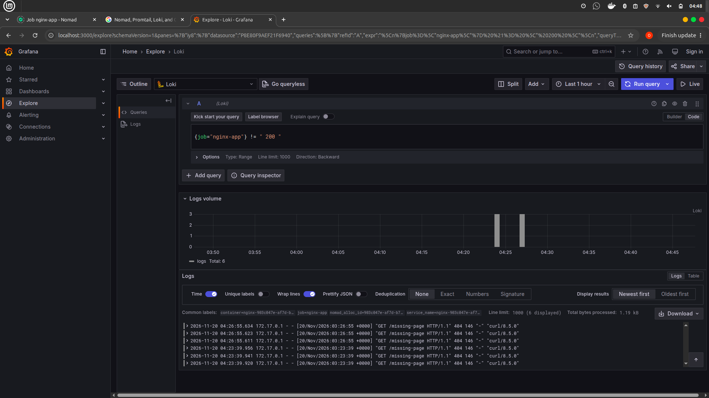

# Loki setup

Stack: Loki 3.4.2, Promtail 3.4.2 and Grafana 11.5.2, defined in `docker-compose.yaml` with pinned image tags. Config is committed in `loki-config.yaml` and `promtail-config.yaml`, not pulled as defaults at runtime.

## How I started it

Nomad runs the application container on the native Docker engine (`/var/run/docker.sock`, root), so the monitoring stack must use the same engine. On my machine plain `docker` points at Docker Desktop, so I use `sudo`:

```bash
cd monitoring
sudo docker compose up -d
sudo docker compose ps
```

Grafana is at http://localhost:3000 with the Loki data source provisioned automatically. Anonymous admin access is enabled for local use only.

## How logs get in

Nomad's Docker driver names containers `nginx-<allocation-id>`. Promtail discovers them through the Docker socket (`docker_sd_configs`, filtered on the name prefix `nginx-`). nginx writes its access log to stdout, so the Docker log driver captures it and Promtail ships it to Loki.

## Label set

| Label | Source |
|---|---|
| `job` | fixed value `nginx-app` set in Promtail relabel config |
| `container` | Docker container name (`nginx-<alloc-id>`) |
| `nomad_alloc_id` | allocation ID taken from the container name by a relabel regex |
| `service_name` | added automatically by Loki 3.x, not configured by me |

## LogQL queries and results

I requested `/` and a missing path (`/missing-page`) from the running Nomad allocation with curl, in two bursts of three requests each.

All access logs for the application:

```logql
{job="nginx-app"}
```

Non-200 responses only:

```logql
{job="nginx-app"} != " 200 "
```

Result: 6 lines, all `GET /missing-page HTTP/1.1" 404`, user agent `curl/8.5.0`, with the labels above attached. `/healthz` is not in the logs because its access log is switched off in `nginx.conf`.



## Problems I hit and how I fixed them

1. **Loki and Promtail exited immediately** with `read /etc/loki/loki-config.yaml: is a directory`. The config files did not exist yet when I first ran `compose up`, so Docker created empty directories where the files should be. Fix: create the files first, remove the stack with `docker compose down -v`, start again.
2. **Port 3000 already allocated.** The first, broken stack was still running its Grafana. Fix: remove the old containers, network and volumes.
3. **Promtail could not see the nginx container.** I had two Docker engines: Docker Desktop (default `docker` context) and the native engine that Nomad uses. Promtail was on Desktop, the application on the native engine. Fix: run the stack with `sudo docker compose`, so both use the native engine.
4. **No logs in Loki at first.** I had set `PORT=127.0.0.1:24085->8080/tcp`, so curl never reached the service (the `>` was also treated as a shell redirect). Fix: use only the port number.
5. **Grafana "parse error: queries require at least one regexp or equality matcher".** I pasted a whole query into the Builder's "Line contains" box, so there was no label selector. Fix: switch to Code mode and enter a single query starting with `{job="nginx-app"}`.
